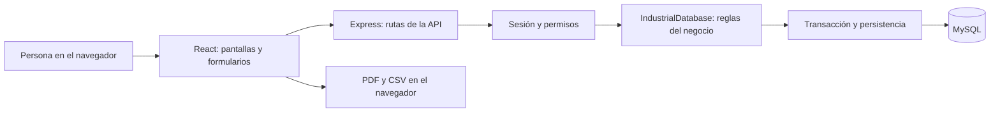

# Sistema de gestión de soldadura PRODIMA

Esta guía explica el proyecto para una persona que no programa y necesita comprenderlo, demostrarlo y definir una tesis. Está basada en el código del repositorio, revisado el 8 de octubre de 2026. Las propuestas académicas son sugerencias; los resultados de mejora requieren medición real.

Para estudiar desde cero, abre el [manual completo en Word](docs/Manual_Proyecto_Soldadura_PRODIMA.docx), que explica cada carpeta y área con ejemplos e incluye los catálogos y guías como anexos. La explicación didáctica también está disponible en [Markdown](docs/MANUAL_PROYECTO.md).

## 1. Qué hace el sistema

Es una aplicación web para administrar máquinas de soldar, técnicos, entrega y devolución de equipos, mantenimientos y contratos de servicio. Permite consultar información resumida, alertas y registros históricos, y descargar reportes.

Por ejemplo: se registra una máquina, se entrega a un técnico autorizado, se registra un mantenimiento y posteriormente se consulta quién la tuvo y qué servicios recibió.

El programa administra información del trabajo de soldadura. No controla eléctricamente una máquina, no mide la calidad del cordón, no recibe datos de sensores y no predice fallas mediante inteligencia artificial.

## 2. Cómo entender el código sin programar

| Palabra | Explicación sencilla |
| --- | --- |
| Frontend | Las pantallas y botones que ve la persona. |
| Backend | La oficina interna que recibe solicitudes, aplica reglas y guarda cambios. |
| Base de datos | El archivo organizado y persistente de la empresa. Aquí se utiliza MySQL. |
| Función | Una tarea con nombre: por ejemplo, registrar una máquina. |
| Parámetro | Un dato que necesita una tarea: por ejemplo, el número de máquina. |
| Variable | Un espacio con nombre que guarda un dato mientras trabaja el programa. |
| Objeto | Una ficha con campos: nombre, marca, estado, etc. |
| Arreglo o lista | Un conjunto de fichas. |
| ID | Identificador numérico de un registro; permite relacionarlo con otros. |
| API | La ventanilla por la que la pantalla solicita operaciones al servidor. |
| Ruta | Dirección de una operación, como `/api/maquinas`. |
| JSON | Formato para intercambiar fichas de datos entre pantalla y servidor. |
| CRUD | Crear, consultar, actualizar y eliminar registros. |
| Validación | Comprobación antes de aceptar una operación. |
| Transacción | Un paquete de cambios que se confirma completo o se deshace. |
| Hash | Resultado de transformar una contraseña para comprobarla sin guardarla como texto legible. |
| Token | Pase temporal que identifica una sesión iniciada. |
| Componente | Pieza reutilizable de una pantalla. |
| Estado de React | Datos que la pantalla recuerda y que pueden cambiar al interactuar. |
| `async` y `await` | Permiten esperar una consulta sin escribir toda la lógica como una sola operación inmediata. |
| `map`, `filter`, `find` | Transformar una lista, seleccionar varios registros y encontrar uno, respectivamente. |
| `import` y `export` | Usar una pieza de otro archivo y permitir que otros archivos usen una pieza. |
| `.ts`, `.tsx`, `.sql`, `.cjs` | TypeScript, pantalla React con TypeScript, instrucciones de base de datos y script JavaScript para Node. |

## 3. Arquitectura: cómo se conectan las partes



React construye la interfaz. Express recibe las solicitudes. `IndustrialDatabase` contiene la mayor parte de las reglas. MySQL conserva los registros después de cerrar el navegador o reiniciar el servidor. El servidor sirve también la interfaz: normalmente ambos se consultan en `http://localhost:3000`.

Una particularidad: cada operación protegida lee las colecciones de MySQL a listas en memoria, ejecuta la lógica y guarda solamente los registros que cambiaron. No es un sistema que conserve sus datos únicamente en memoria; esas listas son una representación temporal de los datos de MySQL.

## 4. Estructura del repositorio

```text
/
├── README.md                     Esta guía
├── docs/GUIA_TESIS.md             Propuesta de tesis y defensa
├── docs/CATALOGO_CODIGO.md        Funciones, archivos y rutas
├── docs/EJECUCION.md              Puesta en marcha y verificación
├── .env.example                  Modelo de configuración
├── .env                          Configuración local, no publicar
├── package.json                  Bibliotecas y comandos
├── package-lock.json             Versiones resueltas de bibliotecas
├── tsconfig.json                 Reglas de revisión de TypeScript
├── shared/types.ts               Estructura común de las fichas
├── scripts/
│   ├── start.cjs                  Inicia la versión compilada
│   └── clean.cjs                  Elimina la carpeta de compilación
├── backend/
│   ├── server.ts                 Inicia Express y verifica MySQL
│   ├── compartido/http.ts        Identifica usuario e IP de solicitudes
│   ├── database/
│   │   ├── schema.sql            Tablas y relaciones
│   │   ├── conexion.ts          Lectura, guardado y transacciones
│   │   ├── operaciones.ts       Reglas principales del negocio
│   │   ├── transaccion-http.ts  Permisos y respuesta segura de la API
│   │   ├── cli.ts               Comandos de MySQL y migración
│   │   ├── mysql.test.ts        Pruebas de lógica y persistencia simulada
│   │   └── alcance.test.ts      Pruebas de acceso por técnico
│   └── modulos/
│       ├── index.ts             Reúne las rutas
│       ├── autenticacion/       Login, sesiones, hashes y alcance
│       ├── usuarios/            Cuentas de acceso
│       ├── tecnicos/            Personal técnico
│       ├── maquinas/            Inventario
│       ├── asignaciones/        Entregas y devoluciones
│       ├── mantenimientos/      Órdenes de servicio
│       ├── contratos/           Contratos de mantenimiento
│       ├── alertas/             Avisos internos
│       ├── historial/           Expediente de cada máquina
│       ├── bitacora/            Acciones registradas
│       ├── dashboard/           Resumen, cálculo mensual y pruebas
│       └── sistema/             Salud y limpieza de datos
└── frontend/
    ├── index.html               Página base
    ├── vite.config.ts           Herramienta de desarrollo y compilación
    ├── public/                  Imagen del logotipo
    └── src/
        ├── main.tsx             Monta la aplicación
        ├── App.tsx              Coordina pantallas, sesión y datos
        ├── index.css            Estilos generales
        ├── components/          Menús, navegación y logotipo
        ├── context/             Preferencia de tema visual
        ├── services/            Solicitudes al servidor
        └── modulos/             Pantallas por área funcional
```

`node_modules` contiene bibliotecas instaladas y `dist` contiene el resultado de compilar. No son el lugar principal para explicar la lógica de tu tesis.

## 5. Pantallas y funciones para el usuario

| Área | Qué permite entender o hacer |
| --- | --- |
| Autenticación | Iniciar sesión con usuario o correo y contraseña; cerrar sesión. |
| Dashboard | Consultar cantidades y gráficos sobre equipos, técnicos, servicios y contratos. |
| Usuarios | Registrar cuentas, modificar información y cambiar estado activo/inactivo. |
| Técnicos | Registrar datos personales, especialidad, puesto, homologación y cuenta vinculada. |
| Máquinas | Registrar marca, modelo, serie, características eléctricas, ubicación y estado. |
| Asignaciones | Entregar una máquina a un técnico y registrar su devolución. |
| Mantenimientos | Registrar servicios preventivos o correctivos, fechas, responsable, proveedor y costo. |
| Contratos | Consultar cobertura, proveedor, vigencia, costo y días restantes. |
| Alertas | Consultar avisos, marcarlos como leídos o eliminarlos. |
| Historial | Reunir asignaciones, servicios, contratos y eventos de una máquina. |
| Bitácora | Consultar acciones registradas con fecha, nombre, módulo e IP. |
| Reportes | Exportar inventario, asignaciones, mantenimientos, contratos, bitácora y resumen ejecutivo a PDF; exportar datos a CSV. |
| Perfil | Actualizar datos del usuario mediante la operación de actualización de usuarios. |
| Apariencia | Elegir tema claro, oscuro o el del sistema; navegar con menús para escritorio y móvil. |

## 6. Datos y relaciones

Hay nueve tablas funcionales y una tabla auxiliar llamada `app_lock`.

| Tabla | Qué guarda | Relación principal |
| --- | --- | --- |
| `usuarios` | Cuenta, rol, estado y hash de contraseña. | Puede vincularse con un técnico. |
| `tecnicos` | Datos del personal y homologación. | `usuario_id` enlaza la cuenta. |
| `maquinas` | Ficha del equipo. | Es el centro de asignaciones y servicios. |
| `asignaciones` | Entrega, devolución, motivo y responsable. | Une técnico y máquina. |
| `mantenimientos` | Servicio, fechas, costo y responsable. | Pertenece a una máquina; puede enlazar técnico y usuario. |
| `contratos_mantenimiento` | Proveedor, número, fechas y condiciones. | Pertenece a una máquina. |
| `historial_maquinas` | Eventos del equipo. | Pertenece a una máquina. |
| `alertas` | Avisos, prioridad y lectura. | Módulo y registro señalan su origen, sin una clave foránea universal. |
| `bitacora` | Acciones del sistema. | Guarda usuario, módulo e identificador; no tiene clave foránea de usuario. |
| `app_lock` | Una fila auxiliar. | Coordina las transacciones concurrentes. |

Una máquina puede tener muchas asignaciones a lo largo del tiempo, muchos mantenimientos y contratos. Un técnico puede recibir varias máquinas, pero la creación normal de asignaciones impide dos asignaciones activas de la misma máquina.

Los campos únicos evitan duplicar correos, nombres de usuario, DPI, códigos de equipo, números de serie no vacíos y números de contrato. Las claves foráneas evitan relacionar ciertos registros con fichas inexistentes. Los índices ayudan a consultar por estado, fecha y otras columnas.

Los costos usan `DECIMAL` en MySQL. El texto usa `utf8mb4`, que admite tildes y otros caracteres. Una fecha de calendario y una fecha con hora no son lo mismo: el programa distingue ambos casos al guardarlos.

## 7. Reglas y automatizaciones importantes

1. Para asignar normalmente una máquina, el técnico debe existir, estar activo y no tener `homologado=false`.
2. Esa asignación se rechaza si ya hay otra activa para el equipo o si está fuera de servicio, en reparación o de baja.
3. Crear una asignación cambia la máquina a `Asignada` y sincroniza el responsable del primer mantenimiento pendiente encontrado.
4. Devolver una máquina finaliza la asignación, registra fecha de devolución y la marca `Disponible`. También finaliza el primer mantenimiento `En proceso` encontrado para ella.
5. Crear un mantenimiento consulta contratos vigentes o próximos a vencer: toma el proveedor del contrato y agrega su referencia a observaciones. Sin contrato, registra esa condición; no bloquea el servicio.
6. Un mantenimiento `Programado` o `En proceso` cambia el equipo a `En mantenimiento`, incluso cuando la fecha programada es futura.
7. El mantenimiento puede crear una asignación al técnico responsable y finalizar una asignación anterior. Si no identifica un responsable, busca el primer técnico activo homologado.
8. Finalizar un mantenimiento deja el equipo `Asignada` si conserva una asignación activa; de lo contrario lo deja `Disponible`.
9. No se permite eliminar el único mantenimiento de una máquina. Sin embargo, crear una máquina no crea automáticamente un mantenimiento: no debe afirmarse que todos los equipos siempre lo tienen.
10. Los contratos no cancelados se consideran vencidos con cero o menos días restantes, próximos a vencer entre 1 y 30 días y vigentes por encima de 30 días. En los últimos siete días el mensaje se vuelve urgente.
11. La revisión de alertas crea avisos de contratos, mantenimientos programados cuya fecha ya llegó y equipos fuera de servicio o de baja. Evita repetir un aviso no leído para el mismo módulo y registro.
12. Los nombres de usuario pueden recibir un número al final para evitar duplicados. Crear un técnico puede crear su cuenta; actualizar uno puede sincronizar la otra ficha.
13. Si falta el código de máquina, se genera uno como `PRD-MILL-202610-001`, usando marca abreviada, año/mes e identificador.

Estas reglas están principalmente en [operaciones.ts](backend/database/operaciones.ts). Algunas merecen revisión con el personal de PRODIMA: devolver un equipo no necesariamente demuestra que el mantenimiento esté terminado.

## 8. Roles y seguridad real

El servidor reconoce Administrador, Supervisor y Técnico. Administradores y supervisores trabajan con el conjunto completo de datos. El técnico consulta su ficha, sus asignaciones, máquinas actualmente asignadas, mantenimientos vinculados y contratos/alertas relacionados. No recibe historial ni bitácora completos.

El técnico no puede realizar cambios generales; puede gestionar sus alertas visibles e iniciar, renovar o cerrar su sesión. La restricción se aplica en el servidor, aunque alguien intente saltarse los botones de la interfaz.

Las contraseñas se almacenan con `scrypt`, una sal aleatoria y verificación mediante comparación resistente a diferencias de tiempo. El token es aleatorio, dura ocho horas y se guarda en memoria del servidor. Al reiniciar el servidor se pierden las sesiones y es necesario volver a ingresar. El navegador recuerda token y usuario en `localStorage`.

La API espera la confirmación de la transacción antes de enviar una respuesta exitosa. Un error o una respuesta rechazada deshace los cambios. Los valores de las escrituras SQL se pasan como parámetros.

Esto no demuestra seguridad absoluta: ver las limitaciones en la guía de tesis.

## 9. Indicadores y reportes

El dashboard muestra total de técnicos y máquinas; equipos disponibles, asignados, en mantenimiento y fuera de servicio; mantenimientos pendientes; contratos vigentes, próximos a vencer y vencidos; y alertas sin leer. También agrupa equipos por estado, servicios por tipo, asignaciones activas por técnico y contratos por estado.

El gráfico mensual cuenta únicamente mantenimientos `Finalizado` según su fecha de fin y el año actual; genera los doce meses incluso si no hay registros. El conteo total de técnicos incluye activos e inactivos. El bloque fuera de servicio del dashboard reúne `Fuera de servicio`, `Reparación` y `Baja`.

Los reportes PDF se generan en el navegador, con encabezados, tablas y fecha de emisión. CSV es texto tabular que puede abrirse en una hoja de cálculo; no es un archivo Excel `.xlsx` nativo. Los reportes describen registros disponibles: por sí solos no prueban ahorro de dinero ni mejora de productividad.

## 10. Cómo ejecutarlo y cómo utilizarlo en tu tesis

Continúa con [la guía de ejecución](docs/EJECUCION.md), [el catálogo de funciones y rutas](docs/CATALOGO_CODIGO.md) y [la guía para definir y defender la tesis](docs/GUIA_TESIS.md).

Orden recomendado para estudiar: entender las pantallas, seguir una entrega y devolución, revisar la ficha de una máquina, comprender las relaciones de datos y finalmente leer las funciones que corresponden a ese proceso.
